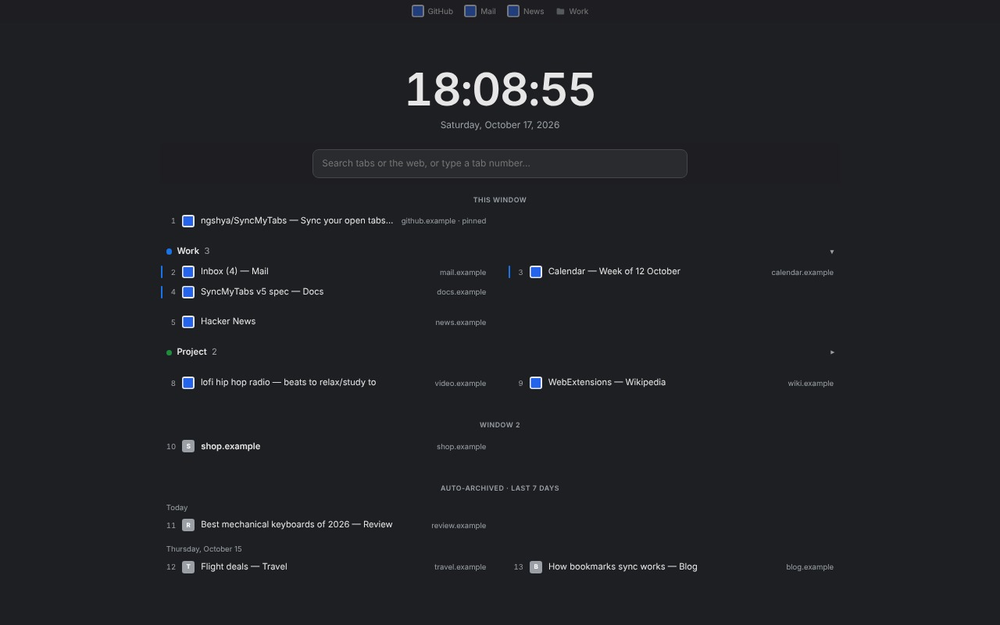

# SyncMyTabs

Sync your open tabs across every device — no server, no account, no cloud.

SyncMyTabs keeps your open tabs in sync everywhere, using the bookmark sync you already trust — your browser's built-in sync, Floccus, xBrowserSync, or anything else. No server of its own. No sign-up. If your bookmarks sync, your tabs sync.

It also turns your new tab page into a list of every tab you have open — by window and tab group, searchable, one keystroke away. Perfect for browsing in full screen, or with the tab bar hidden or kept narrow.

**Install:** [Chrome Web Store](https://chromewebstore.google.com/detail/syncmytabs/cmgailmjkngmopmalbdhnhngdeebinpf)
(Chrome, Brave and other Chromium browsers) — or from source, see [Install from source](#install-from-source).
Works on Chromium browsers and Firefox (tab-group features are Chrome/Brave only).



---

## About this project

SyncMyTabs is an experiment in AI-written software: every line of code, every commit, and this README were written by an AI coding assistant from plain-language instructions, without the human author reading the code. Behavior is verified by the automated tests and by using the extension, not by code review — keep that in mind when deciding how much to trust it.

## Why bookmarks?

Most tab-sync tools need you to trust a server with your whole browsing session. SyncMyTabs piggybacks on a channel you already trust — your bookmark sync — and stays local otherwise: no sign-up, no backend, no telemetry. The trade-off: it's only as good as your bookmark sync.

---

## How sync works

One root folder in your bookmarks ("Other Bookmarks"):

```
SyncMyTabs/
├── default/                ← one folder per profile, shared across devices
│   ├── "Example page"/     ← one folder per open URL
│   │   ├── _url            ← the real URL (the folder name is cosmetic)
│   │   ├── laptop-A        ← one bookmark per device: its open/closed status
│   │   └── phone-B
│   └── …
└── work/ …
```

Each device only ever writes **its own** status bookmark, so devices never fight over the same one.

- **Profiles** (`default`, `work`, …): one is active per device; sync only happens between devices on the same profile. A profile created anywhere becomes selectable everywhere.
- **Opening** a tab marks your device open in that URL's folder; other devices on the profile notice the bookmark change (no polling) and open it too. A brand-new URL is mirrored after a short (20s) confirmation delay, so a stale "still open" snapshot from a slow sync doesn't resurrect a tab that was just closed everywhere.
- **Closing is contagious**: close a tab anywhere and every device closes it; reopen it anywhere and it reopens everywhere. Closing a whole window or quitting the browser never propagates. Navigating a tab elsewhere counts as closing the old URL and opening the new one.
- **Lazy restore** (on by default): mirrored tabs open as placeholders that load only when you click them — a restored video never autoplays just because you switched to its tab.
- **Cleanup**: a device that never comes back has its entries removed after 14 days (adjustable); tabs you keep open are refreshed long before that.
- **Self-healing**: duplicate folders created by some sync tools are merged automatically.
- **Pinned tabs and tabs inside a browser tab group are not synced** (they stay local).

## Other features

- **Tab groups — leashing** (Chrome/Brave only). Give a tab group a title and rules: which pages belong to it (a link clicked inside the group that matches stays in it; anything else opens in a new, ungrouped tab) and which pages it should never be without (reopened automatically). Duplicates are closed, stray tabs ungrouped (optional), groups kept at the start of the window (optional). Rules sync per profile like tabs do. Untitled groups aren't supported. ⚠️ Turn off your browser's own tab-group sync for profiles managed this way — two mechanisms reconciling groups at once can fight.
- **Auto-archive idle tabs** (on by default). A tab you haven't looked at for a while (4 days by default; set in days/hours/minutes) is saved as a bookmark under `SyncMyTabs/<profile>/_archive/<year>/<month>/<day>/` and then closed — never closed without being saved first. Pinned and grouped tabs are never touched. The last days' archive is also listed on the new tab page, one click from coming back.
- **Tab & group order** (off by default). Keeps each window laid out with tab groups first (alphabetical, Chrome/Brave), then tabs by how recently you used them — but only after you've been idle a while (5 minutes by default), and it pauses (30 minutes) after you move a tab yourself.

## The new tab page

Every new tab opens on a minimal page: the time and date, a search box, and everything you have open.

- **Your open tabs, every window**, in tab-bar order, tab groups where they sit and folded as in the browser (click a group's name to fold it on the page). Two columns on a wide window.
- **Recently auto-archived tabs**, by day (last 7 days by default), each one click from being reopened — including those archived on your other devices.
- **Keyboard first**: just type to filter; every tab has a number — type it and press Enter to jump there. Arrow keys move, Delete closes the selected tab (or click the ✕ that appears on hover). Clicking a tab switches to it and closes the new tab page you came from.
- **Search the web from the same box**: Shift+Enter (or Enter when no tab matches) uses your browser's default search engine; an address opens directly. For another service, start with its letter and a space — `g` Google, `m` Maps, `y` YouTube, `c` Claude, `p` Perplexity, `w` Wikipedia, `d` DuckDuckGo — or press Tab to cycle through them. Nothing is sent anywhere before you press Enter.
- **One new tab page per window** (on by default): opening a new one closes the older ones in that window, so they don't pile up.
- **The cursor starts in the search box**, not the address bar (on by default; the address bar then shows the page's own address).
- **Optional**: a copy of your bookmarks bar at the top (so the browser's own can stay hidden), Matrix rain behind the dark themes. Clock in 24-hour format with seconds (both adjustable). Light, dark, black or system theme.
- Favicons are only the browser's own icons for your tabs — never fetched from a third-party service.

Choose what's shown in the settings page's **New tab page** card. The page itself can't be switched off from SyncMyTabs (see Known limitations).

---

## Install from source

**Chrome / Brave:** open `chrome://extensions` (or `brave://extensions`), enable **Developer mode**, click **Load unpacked** and pick this folder.
**Firefox:** open `about:debugging#/runtime/this-firefox`, **Load Temporary Add-on…**, pick `manifest.json` (temporary add-ons go away on restart; a signed build from AMO stays).

On first run a settings tab opens: give this device a name. Repeat on every device, with bookmark sync active on each.

## Settings

- **The popup** (toolbar icon): active profile, an on/off switch per module (tab sync — also the master switch — tab groups, auto-archive, tab & group order), **Sync now**, and **Open full settings**. The icon turns grey with an OFF badge while sync is paused.
- **The full settings page**: device name, profiles (removing one only hides it on this device — its data stays), theme, the background check interval (changes sync immediately regardless), and one card per module — lazy restore, cleanup days and duplicate-tab cleanup (off by default) for tab sync; group rules for tab groups; the idle threshold, "archive now" and "clear archive" for auto-archive; idle and pause minutes for tab order; and the new tab page's own options.

## Requirements & permissions

You need bookmark sync already working between your devices (browser sync, Floccus, xBrowserSync, …) — **SyncMyTabs does not sync bookmarks itself**.

| Permission | Why |
|---|---|
| `bookmarks` | Read/write the SyncMyTabs folder; read the bookmarks bar for the new tab page's copy (only if you turn it on) |
| `tabs` | Read open tabs; open/close/move tabs to mirror, restore, archive and order them |
| `tabGroups` | Tab-group leashing and tab order (Chrome/Brave) |
| `storage` | This device's settings and state |
| `alarms` | The periodic background checks |
| `search` | The new tab page's web search with your default engine (only when you press Enter) |
| `<all_urls>` + content script | Tab-group leashing only: link clicks on pages inside a configured group |

Everything stays on your device; details in [`PERMISSIONS.md`](PERMISSIONS.md).

## Known limitations

- **Sync depends entirely on your bookmark sync.** SyncMyTabs can't tell whether it's healthy.
- **Closing and reopening are contagious by design**: a reopen anywhere reopens on every device that had closed it, whatever the reason it was closed there.
- **A remote open can, rarely, resurrect a just-closed URL** if a device was offline or behind for longer than the 20s confirmation delay — close it again by hand.
- **URLs are matched exactly**: `https://a.com` and `https://a.com/` are two different tabs.
- **Pinned and grouped tabs don't sync**, and the pinned state itself isn't carried over.
- **Tab-group features are Chrome/Brave only**; untitled groups aren't supported; a tab dragged into a group gets leashing only after a reload.
- **Tab order isn't real-time**: it acts periodically, once you've been idle.
- **Archived tabs are bookmarks**: restore older ones from your bookmark manager; there's no separate archive browser.
- **No migration from versions before 4.0**: an old tree is left in place, unused — safe to delete.
- **The new tab page can't be turned off from SyncMyTabs.** ⚠️ On Chrome, choose **"Keep it"** on the prompt shown after installing: **"Change it back" disables the whole extension**, tab sync included.

---

## For developers

No build step: the repository *is* the unpacked extension (edit, then **Reload** it). `npm test` runs the logic tests (a simulated multi-device setup in plain Node), `npm run test:browser` the real-browser tests, `npm run screenshots` takes screenshots. Merging a version bump to `main` publishes Chrome and Firefox zips as a GitHub Release automatically. How the code is organized: [`CLAUDE.md`](CLAUDE.md) and [`docs/`](docs/). Store copy and policies: [`STORE_LISTING.md`](STORE_LISTING.md), [`PRIVACY.md`](PRIVACY.md), [`PERMISSIONS.md`](PERMISSIONS.md).

## Privacy

No server, no account: SyncMyTabs collects, transmits, sells and shares **nothing**. Everything stays on your device and in your bookmarks; your own bookmark sync moves it between devices. Privacy policy: [`PRIVACY.md`](PRIVACY.md) (<https://github.com/ngshya/SyncMyTabs/blob/main/PRIVACY.md>).

## License

**PolyForm Noncommercial License 1.0.0** — see [LICENSE](LICENSE). Free for any noncommercial purpose (personal, research, education, nonprofits, government…); **commercial use is not permitted** — contact the author for a commercial license.
